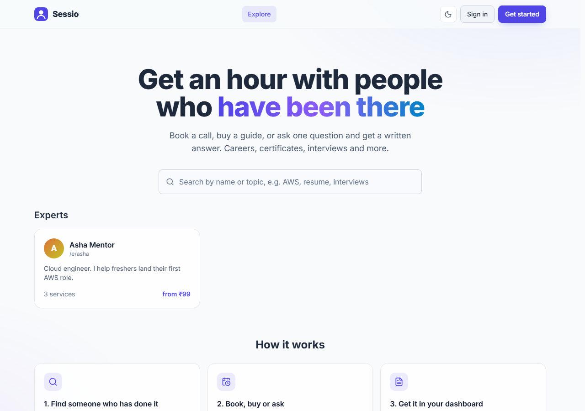
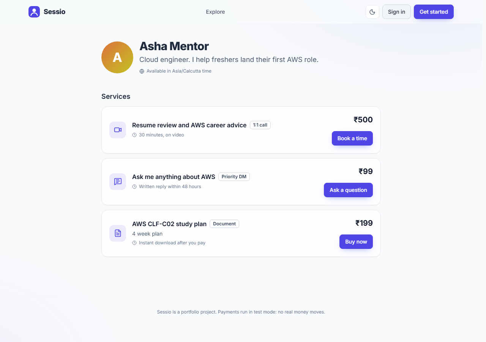

# Sessio

A marketplace where experts sell their time and knowledge, and anyone can book it. An expert gets one shareable page with three kinds of service:

- **1:1 video call**: the buyer picks a free time, pays, and gets a private video room.
- **Document**: a guide or template the buyer downloads after paying.
- **Priority DM**: the buyer sends one question and gets a written answer.

Payments run in **Razorpay test mode** (or a built-in demo mode with no account), so no real money ever moves.





## What it does

| For buyers | For experts |
|---|---|
| Search experts by name or topic | Create a page in a minute (`/e/your-name`) |
| Pick a day and time, shown in your own time zone | Add calls, documents and priority DMs with their prices |
| Pay, then get the video link, the file or the answer | Set weekly hours once; free times are worked out for you |
| "My bookings": upcoming and past calls, documents, messages | Studio: earnings, orders, a reply box for DMs |

## How it is built

**Backend**: FastAPI, SQLAlchemy, pydantic v2. SQLite by default, Postgres with one `DATABASE_URL`. Login with JWT and pbkdf2 password hashes.
**Frontend**: React 19, TypeScript, Tailwind, react-query, light and dark themes.

Decisions worth reading:

- **No double booking.** A unique constraint on the call slot is the real guard, so two people paying at the same instant cannot both get it. The loser sees a clear message and fresh times.
- **Hold, then pay.** Choosing a time holds it for 15 minutes. If payment never completes, the time is free again.
- **Time zones.** Experts set weekly hours in their own zone. Slots are computed to UTC and shown in each viewer's zone.
- **Money in paise** (integers), never floats.
- **Payments verified on the server.** The server creates the Razorpay order; the browser opens Checkout with only the public key; the server checks the HMAC-SHA256 signature of `order_id|payment_id` with the secret before confirming. Without keys the same flow runs in demo mode.
- **Safe downloads.** Files are served as attachments with `application/octet-stream` and `nosniff`, only to the buyer who paid and to the seller. Uploads need a seller declaration (own the file, no one else's personal contact details).
- **Security is built in, not added on.** Strong password hashing, brute-force lockout, forged-token rejection, content-checked uploads, CSP and other headers, strict CORS, a signed Razorpay webhook, and a production mode that refuses to start with unsafe settings. Everything is listed, with the test that proves it, in [docs/SECURITY.md](docs/SECURITY.md).
- **Tests.** 68 tests cover accounts, slot maths, double booking, holds, documents, DMs, payment verification and the security rules. They also pass on Postgres (`TEST_DATABASE_URL`).

## Run it

You need Python 3.13 and Node 22.

```bash
cd backend
python -m venv .venv
.venv/Scripts/python -m pip install -r requirements-dev.txt
.venv/Scripts/python -m uvicorn app.main:app --port 8010
```

```bash
cd frontend
npm install
npm run dev
```

Open http://localhost:5190. With no keys set, payments use the demo button (laptop only: on a public site it would let anyone book for free, so production refuses it unless you switch it on on purpose).

### Real Razorpay (test mode)

Create a free Razorpay account, switch to Test Mode, generate test keys, and put them in `.env` (copy `.env.example`):

```
RAZORPAY_KEY_ID=rzp_test_...
RAZORPAY_KEY_SECRET=...
```

Restart the API. Booking now opens the Razorpay window; use Razorpay's published test cards. Keep the secret out of Git: `.env` is ignored.

For payments to be confirmed even when the buyer closes the tab, add the webhook described in [docs/SECURITY.md](docs/SECURITY.md#setting-up-the-razorpay-webhook-recommended-for-any-real-use).

### Docker

```bash
cp .env.example .env   # then set JWT_SECRET
docker compose up --build
```

Site on http://localhost:5190.

### Tests

```bash
cd backend
.venv/Scripts/python -m pytest -q
```

## Deploy for free

Vercel (site) + Render (API) + Neon (Postgres): see [docs/DEPLOY.md](docs/DEPLOY.md).

## Scope and honest limits

- Test-mode payments only; nothing is paid out to experts. The 10% platform fee is shown in earnings for demonstration.
- No refunds or buyer cancellation of paid bookings yet. No email verification, password reset or two-factor sign-in (see the limits in [docs/SECURITY.md](docs/SECURITY.md)).
- Files are stored in the database (limit 5 MB each), fine for a demo; a real product would use object storage.
- Sessio does not list or sell anyone's personal phone numbers or contact details, and uploads that do are against the seller declaration.
